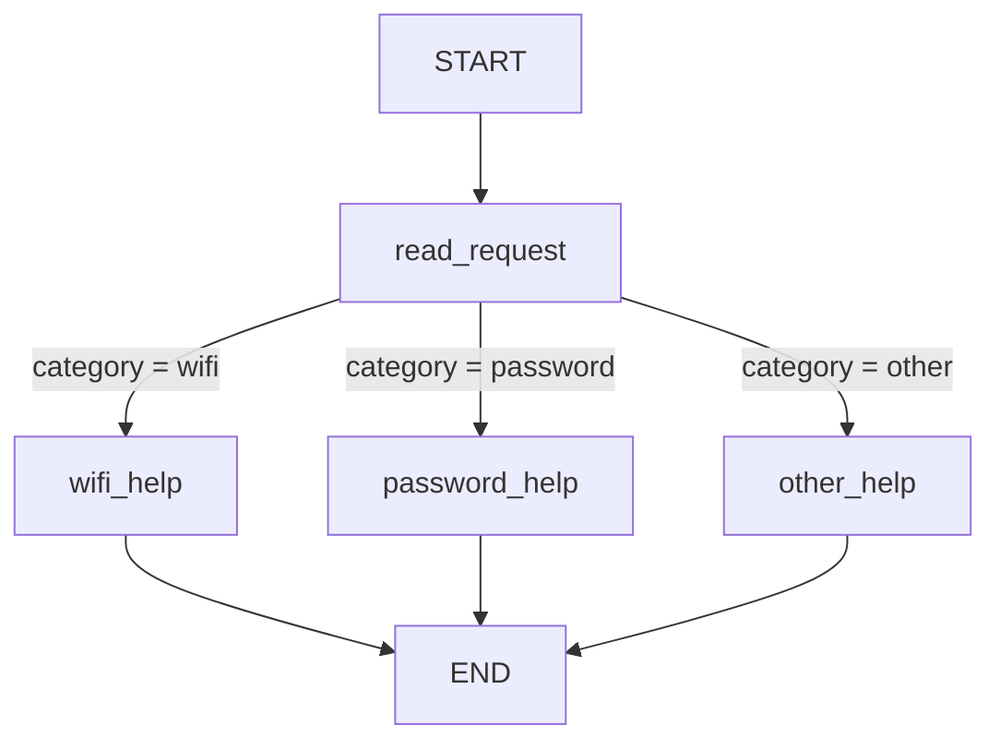
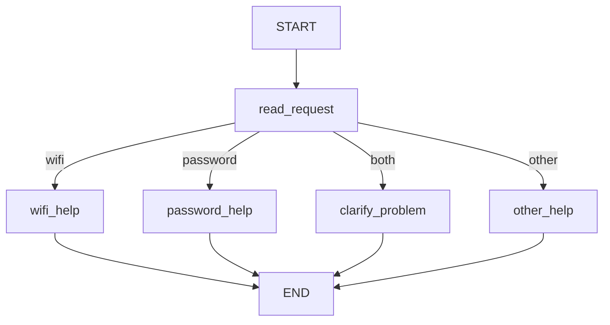
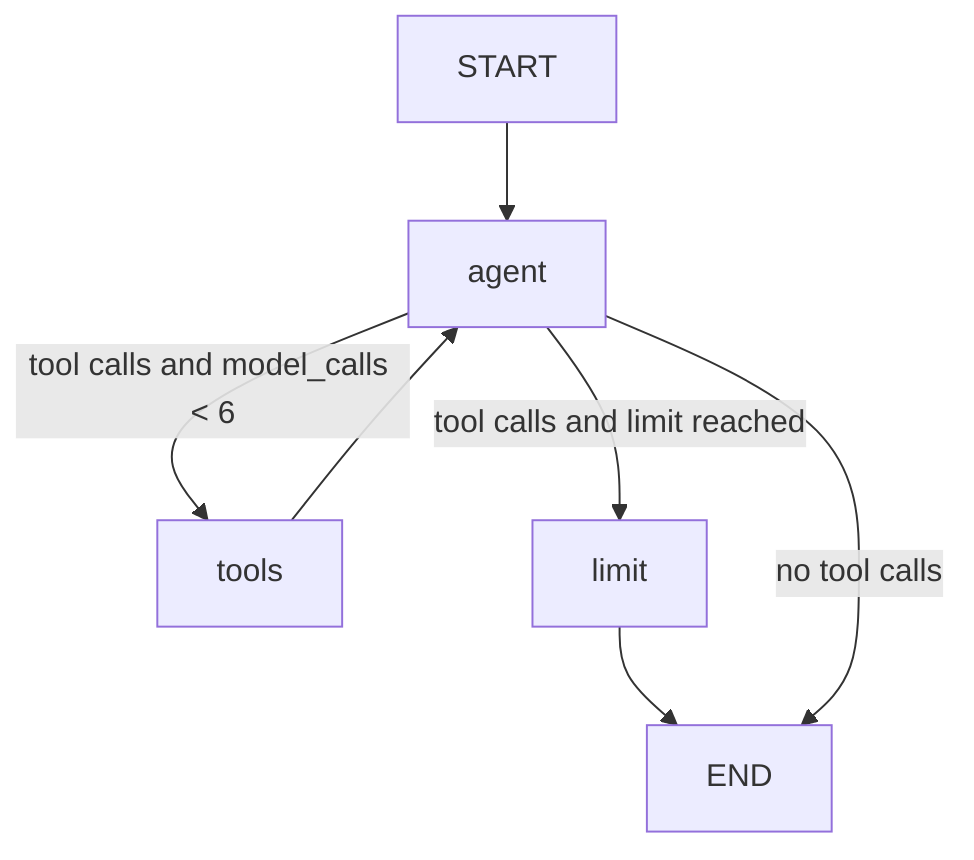

# HW5 — My LangGraph helpdesk

Python 3.12 · LangGraph · Google AI Studio (Gemini) via `langchain-google-genai` · SQLite.
Run commands are in [README.md](README.md). All logs are in `outputs/`.

## Part 1 — How the graph works

### My graph and state

State: `message` (the user's original text, never changed), `category` (set by `read_request`),
`reply` (set by one help node).

| Node / function | Reads | Changes |
| --- | --- | --- |
| `read_request` | `message` | sets `category` (`classify()` in `classify.py`) |
| `wifi_help`, `password_help` | nothing in the state (they read `data/helpdesk.json`) | set `reply` |
| `other_help` | nothing | sets `reply` (asks Wi-Fi or password?) |
| conditional edge `route_after_read` | `category` | nothing; returns the next node's name |

1. **What does each node read and change?** See the table. Only `read_request` needs the message.
2. **Update vs conditional edge.** A node returns an *update* (a partial dict that LangGraph merges
   into the state). A conditional edge is a function that *reads* the state and returns the name of
   the next node; it changes nothing.
3. **What does the next node receive?** The current graph state (all fields merged), not just the
   previous node's update. In `outputs/S01.json` the `state_after` of `wifi_help` still contains
   `message` and `category` although `wifi_help` only returned `reply`.
4. **START, END, compile.** `START` and `END` are the virtual entry and exit points. `compile()`
   checks that the graph is well formed and turns the builder into a runnable object.

### Predictions before running

| Message | Predicted route (from the rules) | Actual route | What I learned |
| --- | --- | --- | --- |
| I cannot connect to Wi-Fi. | Contains "wi-fi" → rule 1 → wifi_help | START → read_request → wifi_help → END (`category: wifi`) | The lowercase "wi-fi" alias matches "Wi-Fi". |
| I forgot my PASSWORD. | No Wi-Fi word; contains "password" (case ignored) → rule 2 → password_help | START → read_request → password_help → END (`category: password`) | Matching ignores case: "PASSWORD" works. |
| My laptop screen is broken. | Neither word → rule 3 → other_help | START → read_request → other_help → END (`category: other`) | Anything outside the two topics falls back to a question. |
| My Wi-Fi password does not work. | Contains both words; the Wi-Fi rule is checked first → wifi_help, password part ignored | START → read_request → wifi_help → END (`category: wifi`) | The Wi-Fi rule is checked first, so the password part is silently ignored. |

Note: I filled the predicted column from the routing rules in the brief after my first run, so it is not a blind prediction made before seeing the trace.

When a message mentions both topics the first matching rule wins (the Wi-Fi rule), so the user gets
Wi-Fi steps for what may be an account problem.

### My change to the graph

New trace for "My Wi-Fi password does not work." (S05, `outputs/S05.json`):
`read_request` set `category: both`, then `clarify_problem` set the reply
"Is the problem connecting to Wi-Fi, or recovering your account password? …".
The route changed, not just the final sentence: `wifi_help` is no longer visited.
The other three messages still take their old routes.

**What LangGraph controls:** running nodes in order, merging each update into the state, following
the edges and stopping at `END`. **What my functions decide:** the keyword rules in `classify()`
(including the new "both" case), the mapping in `route_after_read`, and the text of every reply.

## Part 2 — Model and tools

Model and provider: Google AI Studio (Gemini); the exact model name is in the `model` field of
`outputs/S06.json`. Tools (`helpdesk/tools.py`): `find_instructions`, `check_service_status`,
`prepare_ticket`. Direct calls without a model or graph: `python -m helpdesk.run_part2 --tools-demo`
→ `outputs/part2_direct_tool_calls.json` (instructions found / not found, status of two services,
a ticket refused for missing details, a ticket saved).

1. **Tool or answer?** After the `agent` node, `route` checks whether the model's last message
   contains tool calls: tools → `tools` node; tool calls but limit reached → `limit` node; none → `END`.
2. **Who requests, who executes?** The model only *requests* (its message carries `tool_calls` with
   a name and arguments). LangGraph's `ToolNode` runs my Python function.
3. **What changes after a result?** A tool message is appended to `messages` (the `add_messages`
   reducer appends instead of overwriting); then `agent` runs again and `model_calls` grows by 1.
4. **Difference from Part 1.** In Part 1 my keyword rules fixed the route. Here the model decides
   which tool (if any) to call and with which arguments, and the number of steps is not known in
   advance; I only bound it.

**Loop limit:** `MAX_MODEL_CALLS = 6` model calls per user message, enforced in `route`
(`helpdesk/agent.py`). When it triggers, the `limit` node answers every pending tool call with
"not executed" and stops with an honest message. It is tested with a fake model that requests a tool
forever (`test_loop_limit_stops_endless_tool_calls`). In my real runs the limit was never reached
(`loop_limit_reached: false` in the logs).

**Actual runs:** S06 (`outputs/S06.json`): `find_instructions` → then `check_service_status`
(operational) → `prepare_ticket` with only the two steps I stated. S07 (outage): only
`check_service_status`, no ticket. S08 (status unknown): only `check_service_status`, then it asks
whether to draft a ticket. The same conditional request led to three different outcomes.

## Part 3 — Memory

- **Conversation state** = LangGraph checkpointer `SqliteSaver` (`storage/conversations.sqlite`),
  keyed by `thread_id`. A `thread_id` identifies *one conversation*; the same `thread_id` resumes it.
- **User identifier** (`user_id`) identifies *a person*. It is separate from `thread_id`: one user
  can have many threads.
- **User preference storage** = my own `sqlite3` table (`helpdesk/memory.py`,
  `storage/user_memory.sqlite`) keyed by `user_id`. The model saves a preference with the tool
  `remember_preference`; the tool is bound to the current `user_id`, so the model cannot write for
  another user. At the start of every turn the node `load_user_memory` reads that user's rows into
  the state, and they appear in the system prompt.
- **Retrieval vs memory.** Looking up Wi-Fi instructions is *retrieval*: the same fixed reference
  (`helpdesk.json`) for everyone. Recalling "reply in Kazakh" is *memory*: information the user gave
  me, saved for them alone and written back to storage.

| Situation | Command used | Log file | What happened |
| --- | --- | --- | --- |
| Refer to an earlier message | `python -m helpdesk.main --scenario S10` | `outputs/S10.json` | "Which steps did I already try?" was answered from the saved thread: enabling Wi-Fi, forgetting the saved network, reconnecting. Source: conversation state (4 earlier messages). |
| Close, restart and resume | `python -m helpdesk.main --scenario S11` (the runner closes every connection and rebuilds the program, keeping `storage/`) | `outputs/S11.json` | After the restart the assistant recalled the Wi-Fi problem and steps, in Kazakh. Sources: conversation state (5 earlier messages) and user memory `{language: Kazakh}`. |
| Same user, new conversation | `python -m helpdesk.main --scenario S12` | `outputs/S12.json` | New thread `preference-a2`: conversation state "none (new thread)", user memory loaded `{language: Kazakh}`; it answered in Kazakh and listed what it can help with. |
| Different user | `python -m helpdesk.main --scenario S13` | `outputs/S13.json` | `demo-user-b` loaded `{}`; the answer said nothing is recorded for this user. |

**Real restart (four separate launches).** The scenario runner above simulates a restart inside one
process, so I also ran four separate launches of the program (each command is its own process, nothing
carried over except the files in `storage/`). I started with `python -m helpdesk.main --reset`.

| Launch | Command (shortened) | What happened | Log |
| --- | --- | --- | --- |
| 1 | `--user demo-user-a --thread restart-a --message "Please remember that I prefer replies in Kazakh. My issue is Wi-Fi. …"` | The model called `remember_preference` (saved `language = Kazakh`) and `find_instructions`; the reply was in Kazakh. Sources: user memory written `[language: Kazakh]`, conversation "none (new thread)". `dir storage` then showed `conversations.sqlite` and `user_memory.sqlite`. | `outputs/chat_demo-user-a_restart-a.json` |
| 2 | `--user demo-user-a --thread restart-a --message "Which problem and steps did we discuss?"` | A new process; I did not retype the old message. The reply recalled the Wi-Fi problem and the steps, in Kazakh. Sources: conversation "5 earlier messages saved for this thread_id", user memory loaded `{language: Kazakh}`. | `outputs/chat_demo-user-a_restart-a.json` |
| 3 | `--user demo-user-a --thread brand-new --message "Which language did I ask you to use?"` | Same user, new thread: the reply said Kazakh. Sources: conversation "none (new thread)", user memory loaded `{language: Kazakh}`. So the preference came from user memory, not from replaying the old conversation. | `outputs/chat_demo-user-a_brand-new.json` |
| 4 | `--user demo-user-b --thread isolation-b --message "Have I told you a preferred language or a previous problem?"` | The reply said nothing has been recorded. Sources: user memory loaded `{}`. | `outputs/chat_demo-user-b_isolation-b.json` |

## Part 4 — Running and checking my work

- Setup, run commands, API key setup and Python version: [README.md](README.md).
- Versions: `requirements.txt` (generated by `python scripts/pin_requirements.py` after the tests
  passed; it pins the direct dependencies, not every transitive one).
- Memory files: `storage/` (ignored by git); clear with `python -m helpdesk.main --reset`.
- CI: `.github/workflows/tests.yml` runs `python -m pytest -q` on each push, with no API key.
- Fake model: `ScriptedModel` (tests/test_part2.py, tests/test_part3.py) replays a scripted list of
  replies. Tests that use it check my plumbing, not the real model's judgement. The real Gemini
  demonstration (`python -m helpdesk.main --all`) is separate and not run in CI.

| Test | What it would catch if the code broke |
| --- | --- |
| `test_part1_classify.py` — `test_original_rules` (5 messages), `test_both_topics_detected_in_changed_graph` | A broken keyword rule, case-sensitivity, the Wi-Fi-first priority, or the "both" detection. |
| `test_part1_graph.py` — wifi / password / other route, two topics original vs changed, message kept and reply set | A node wired to the wrong edge, `clarify_problem` not reached, state fields lost between nodes. |
| `test_part2.py` — `test_status_follows_selected_profile`, `test_recovery_outage_only_affects_account_recovery` | A tool ignoring the selected snapshot, or mixing up Wi-Fi and account recovery. |
| `test_part2.py` — `test_unknown_topic_is_not_invented` | `find_instructions` making up a guide for an unknown topic. |
| `test_part2.py` — ticket tests (missing details, template and user steps, secrets) | A ticket written with missing details, invented steps, wrong template fields, or a password. |
| `test_part2.py` — `test_loop_passes_tool_result_back_to_model`, `test_loop_limit_stops_endless_tool_calls` (fake model) | A tool result not returned to the model, or a loop that never stops. |
| `test_part3.py` — memory store (reopen, isolation, overwrite) | Preferences lost after closing, leaking to another user, or duplicated rows. |
| `test_part3.py` — remember tool (current user only, refuses secrets, absent without a store) | The model writing for another user, or saving a password or key. |
| `test_part3.py` — `test_conversation_survives_restart` (fake model) | A conversation not restored from SQLite after a new launch. |
| `test_part3.py` — `test_preference_crosses_threads_but_not_users` (fake model) | The preference missing in a new thread, replayed old messages, or leaking to user B. This test also caught a real problem: my prompt example contained "Kazakh", so I changed the example to a neutral one. |

Latest result of `python -m pytest -q`: **30 passed in 1.19s** (Python 3.12.3; langgraph 1.2.19, langchain-core 1.7.4, langchain-google-genai 4.4.2, langgraph-checkpoint-sqlite 3.1.3, pytest 9.2.0).

## Choices and limitations

**Choices.** `SqliteSaver` is the supported LangGraph way to persist conversations locally, so I
used it for thread state. For preferences I used a plain `sqlite3` table keyed by `user_id`: it is
a few lines, easy to inspect, and makes the per-user isolation explicit. I used Gemini through
`langchain-google-genai` because I have a Google AI Studio key; I replaced the starter's OpenAI
adapter. Retries with waiting, plus optional fallback models, handle overload (503) and quota errors.

**Limitations.**
- Model behaviour is not deterministic; each scenario was run once, so another run may differ.
- In S09 the model also called `check_service_status` on its own, which the user did not ask for.
  It is harmless (the ticket then states a known status) but I could tighten rule 3 in the prompt.
- The secret filter is a simple pattern check; it will miss unusual formats.
- Preferences are free-form name/value pairs with no way to delete one except `--reset`.
- `user_id` is just a command-line argument; there is no real login.
- `requirements.txt` pins direct dependencies only.
- Only the Part 1 graph and the tools are fully deterministic and tested without a model.

## Supplied scenarios — my actual results

S01–S05: `python -m helpdesk.run_part1 --all`. S06–S14: `python -m helpdesk.main --all`
(or `--scenario <ID>`).

| Scenario | Command or manual steps | Log file | What happened / what I changed |
| --- | --- | --- | --- |
| S01 — Simple Wi-Fi route | `python -m helpdesk.run_part1 --scenario S01` | `outputs/S01.json` | read_request → wifi_help; reply = GUIDE-WIFI steps. Matched expectation. |
| S02 — Case-insensitive password route | `… --scenario S02` | `outputs/S02.json` | "PASSWORD" → category password → password_help (GUIDE-PASSWORD). Matched. |
| S03 — Unsupported request | `… --scenario S03` | `outputs/S03.json` | category other → other_help asks Wi-Fi or password. Matched. |
| S04 — Two topics before the graph change | `… --scenario S04` | `outputs/S04.json` | Original graph: Wi-Fi rule first, so wifi_help; the password part is ignored. I changed the graph for S05. |
| S05 — Two topics after adding clarification | `… --scenario S05` | `outputs/S05.json` | category both → clarify_problem asks which problem to solve first. The route changed, not only the sentence. |
| S06 — Instructions then local ticket | `python -m helpdesk.main --scenario S06` | `outputs/S06.json` | Turn 1: find_instructions. Turn 2: check_service_status (operational) → prepare_ticket with the two steps I stated; ticket `tickets/TKT-20261104-203721-53c9be.json`; says nothing was sent. |
| S07 — The same request during a Wi-Fi outage | `… --scenario S07` | `outputs/S07.json` | Status outage → no ticket, explained, no repair time invented. |
| S08 — Status source unavailable | `… --scenario S08` | `outputs/S08.json` | Status unknown → "cannot confirm", asked whether I want a draft explaining the status could not be checked; no ticket created. |
| S09 — Missing ticket details | `… --scenario S09` | `outputs/S09.json` | Turn 1 asked for the problem and steps (no tool call). Turn 2 created `tickets/TKT-20261104-204345-d5c82f.json` with my two steps. The model also checked the status unasked (see limitations). |
| S10 — Use the current conversation | `… --scenario S10` | `outputs/S10.json` | Listed enabling Wi-Fi, forgetting the network and reconnecting from the saved thread. |
| S11 — Persist and recall after restart | `… --scenario S11` | `outputs/S11.json` | Saved language Kazakh via remember_preference; after the restart recalled problem and steps, in Kazakh. |
| S12 — Preference across threads without replay | `… --scenario S12` | `outputs/S12.json` | New thread: no conversation history, but user memory gave `language: Kazakh`; replied in Kazakh. |
| S13 — Do not share memory between users | `… --scenario S13` | `outputs/S13.json` | demo-user-b: empty memory; said nothing is recorded. |
| S14 — Password recovery outage | `… --scenario S14` | `outputs/S14.json` | Looked up account_recovery (not wifi) → outage; no repair time invented. |
